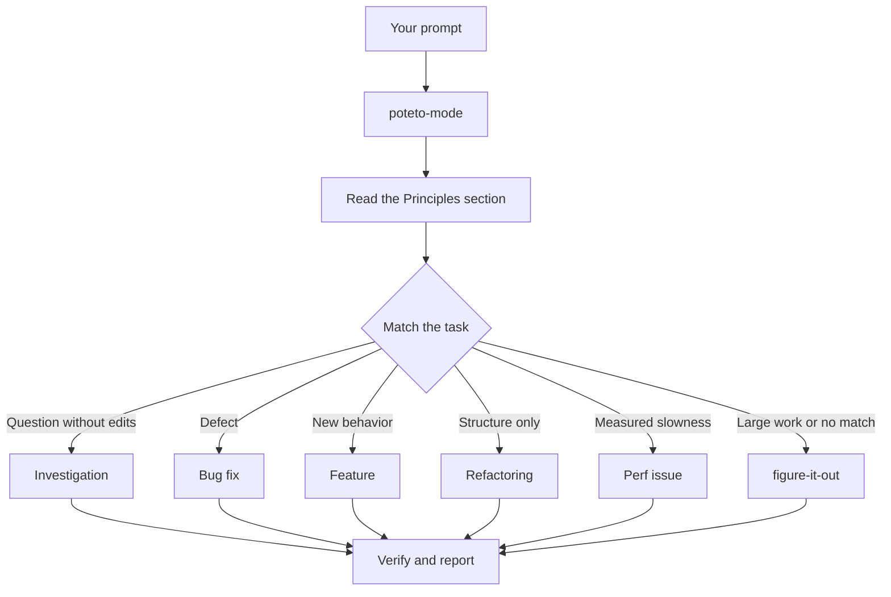

# Route work through `/poteto-mode`

`/poteto-mode` matches your goal to one of 23 playbooks. It copies the selected playbook's steps into the available task list and calls the other skills when a step needs them. This page shows how to state the goal and its acceptance check.


## What happens to your prompt



The diagram shows the common routes. The [playbook directory](../../skills/poteto-mode/playbooks/) also covers performance measurement and captured traces. Other playbooks handle prototypes, skill development, and delivery. Programs that span several sessions have their own coordination and continuation instructions.

## State the goal

You don't write a spec. You say what's wrong or what you want, plus anything you already know that saves the agent time:

```text
/poteto-mode users get two notifications after a retry. repro first, then fix and verify.
```

That's a Bug fix prompt. "repro first" is a real constraint, not politeness, and the playbook honors it. Watch the todo list fill with the Bug fix steps. A skipped step stays visible with `skip: <reason>`.

## What goes in a prompt

A useful prompt carries up to five things, and each one fits in a sentence:

- **The goal.** Say what's wrong, or what you want.
- **The done check.** It must be able to pass or fail. "Make it better" and "work on it for an hour" aren't checks.
- **The proof you want to see.** Ask for the real command output, a video of the flow, the stored value, or a comparison between measurements.
- **What you already know.** A symptom, a repro step, a log line, or a link saves the agent a search.
- **The real constraints.** "repro first", "don't change any code yet", "zero behavior change", and "let me review before proceeding" each change what the agent does.

Here's one prompt with all five:

```text
/poteto-mode the csv export drops its last row since yesterday's deploy. failing job id is 4812. repro first, then fix. done means the 60k-row fixture exports every row. show me the row counts before and after.
```

Two things are worth leaving out:

- **The how.** Say what to achieve, and leave the agent room to find a better path than the one you'd pick. The same goes for a list of skills, covered in the pitfall below.
- **Your theory of the cause, at first.** A stated guess narrows the search to wherever you pointed. Let the agent restate the problem before you share your hunch.

For a noisy report, such as a long thread or a vague bug, make the restatement the first step:

```text
/poteto-mode read this thread. restate the underlying issue in your own words, in plain english. don't change any code yet.
```

A misreading shows up in the restatement, before any code exists. Correct it there, and it costs you one message instead of one wrong fix. For the restatement alone, with no playbook, run [`/in-your-own-words`](../../skills/in-your-own-words/SKILL.md). It restates what the agent thinks your goals are and what problem you're trying to solve.

When you're unsure whether a task is aimed right, put [`/sharpen`](../../skills/sharpen/SKILL.md) in front of it:

```text
/sharpen write a migration guide for the v2 config format.
```

Before it starts, the agent asks how a top expert would do the task, what you're really after, and whether the ask is over- or underspecified. It drops constraints that don't serve the goal as readily as it adds ones that do, leaves your choices open, and keeps one outside check that the result is right. Then it does the work.

## Follow up short

When the conversation already carries the context, the prompt shrinks to almost nothing. All of these are enough:

```text
/poteto-mode do it
```

```text
continue
```

```text
keep going until done
```

Short prompts work when the current conversation already states the goal and constraints. Instruction persistence differs by host. [Setup](./01-setup.md#run-your-first-task) explains when to invoke the skill again.

## Switch tasks with "new task"

A long chat accumulates context from the last task. When you change subjects, say so:

```text
/poteto-mode new task. figure out why the cache entry survives logout. don't change any code yet.
```

"new task" tells `/poteto-mode` to select a new playbook rather than continue the prior playbook. "don't change any code yet" pins this one to Investigation. Without those two phrases, a mode following the Feature playbook tends to treat your question as the next feature step.

## Isolate parallel work

Concurrent writers need separate worktrees or directories. Give each attempt its own files. Isolate runtime ports and build output when those resources can conflict. Use a remote worker only when the host offers one and the task authorizes it. A remote worker follows the same permissions as the parent task.

When the work has to stay local, ask for a worktree up front:

```text
/poteto-mode new task. branch off <base> in a fresh worktree, then port the parser change there.
```

A separate branch and worktree keep file changes apart. Local workers still share machine resources, so limit concurrency to what the host can support. The [Opening a PR playbook](../../skills/poteto-mode/playbooks/opening-a-pr.md) describes the worktree workflow for code changes.

Worktrees accumulate. When disk gets tight, ask:

```text
/poteto-mode what's eating my disk? prune the worktrees that are safe to prune.
```

The [Worktree cleanup playbook](../../skills/poteto-mode/playbooks/worktree-cleanup.md) checks merge state and local changes. It also checks whether active work still uses a worktree. Cleanup requires authority and evidence that deletion is safe. Dirty or uncertain work waits for your decision.

## Leave it running

When you step away, say what done means and go:

```text
/poteto-mode im stepping away. keep going until the migration check reports zero old callers. log your decisions.
```

Work you'll review later routes through [`/figure-it-out`](../../skills/figure-it-out/SKILL.md), which designs the run's phases and keeps a [`/show-me-your-work`](../../skills/show-me-your-work/SKILL.md) decision log. [Run work while you sleep](./07-overnight.md) covers the full overnight contract.

**Pitfall:** don't enumerate skills in your prompt ("use /how, then /architect, then /arena..."). The playbook already sequences them, and a sequence written by hand usually reorders or drops steps the playbook would have kept. Name a skill only when you want to override a specific choice.

Read [`poteto-mode`](../../skills/poteto-mode/SKILL.md) itself for the full routing rules.

Next: [Understand the code](./03-understand.md).
