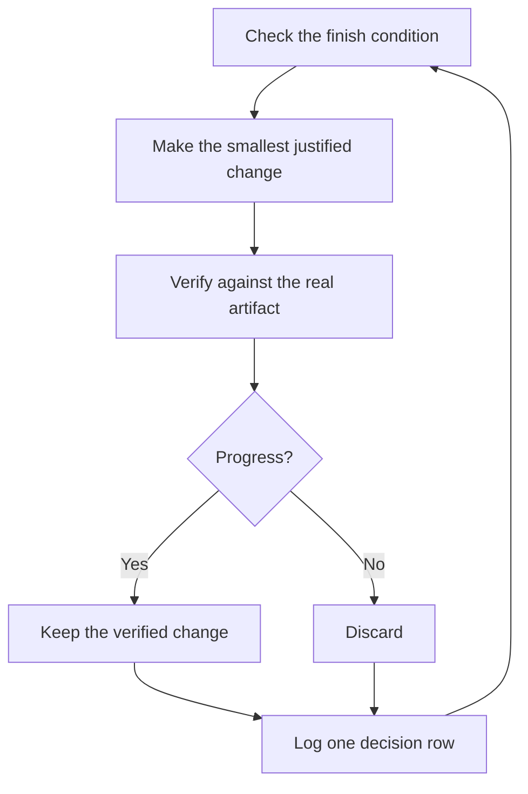

# Run work while you sleep

Before leaving an agent running, give it a checkable finish condition and an isolated place to work. Keep a decision log for the choices you will review later. The run remains subject to the permissions you granted.


## Earn the trust before the loop

A loop you don't trust just produces unchecked work faster, and the mess compounds with every iteration. Before you leave one running, check that it has earned it:

- You've done the task once by hand, or watched an agent do it, so you know what good looks like.
- The agent has the tools and signals you'd use yourself: the verification skill, the profiler, the logs.
- Every stage proves its work and can stop the line when the work misses the bar.
- You've read a few transcripts and turned the repeated failures into tools, skills, or checks.

Make the loop autonomous only after all four hold. Until then, run it while you watch.

## The overnight contract

A good handoff has the goal, the finish condition, permissions, and an escape hatch. It doesn't need to be long:

```text
/poteto-mode im going to bed. migrate every caller to the new parser in a fresh worktree off <base>.
done means zero old callers, all parser fixtures pass, old api deleted.
keep a decision log. don't ask me before committing.
continue until done. if you're truly stuck after a few hours, stop and write up why.
```

Walk through what each line buys you:

- "im going to bed" asks the agent to continue within the authority already granted. A required approval still waits.
- "done means..." turns the goal into checks every iteration can run.
- "fresh worktree off `<base>`" keeps the run from colliding with anything else you have open.
- "don't ask me before committing" authorizes commits within the stated task.
- The [Autonomous run playbook](../../skills/poteto-mode/playbooks/autonomous-run.md) uses the active host's supported continuation mechanism to check the finish condition. Without one, it leaves a precise continuation instead of creating a hidden daemon.
- The escape hatch lets it stop at a genuine dead end and write up why, which beats eight hours of creative goal reinterpretation.

Because you'll review this work after stepping away, `/poteto-mode` routes it through [`/figure-it-out`](../../skills/figure-it-out/SKILL.md), which designs the run's phases before any code and wires in the decision log.

To stop a run, tell the agent to pause or that you are about to restart the host. The [Pause safely playbook](../../skills/poteto-mode/playbooks/pause-safely.md) finishes or reverses its current step when that is safe. It records a checkpoint and a resume note. It commits only when authorized. A fresh chat can use the Session pickup playbook to resume from that note. Saying "keep going" continues the task.

## What the loop does all night



Each iteration makes a justified change, verifies it, then records the decision. The agent reverts its own unsuccessful attempt when doing so is safe and authorized. A plateau calls for another hypothesis. It never weakens the finish condition to report success.

## The morning audit

[`/show-me-your-work`](../../skills/show-me-your-work/SKILL.md) records each decision in a TSV. The row includes its time and phase, followed by the reason and an evidence pointer. It also records the result. Use `decisions.tsv`, or `.audit/<task-slug>.tsv` when several runs share a directory. The trail stays local unless delivery is authorized.

When you're back, ask for the run in review form:

```text
/show-me-your-work catch me up on what you did last night
```

When the host permits delegation, the skill asks an independent reviewer to read the trail and available scoped transcript. A different model family is optional and depends on host support. Without those capabilities, it reports the limits of the audit. The reply identifies the decisions that need your attention and points to their evidence.

For a quick status instead of an audit, run [`/ketchup`](../../skills/ketchup/SKILL.md) in the chat that ran the work. It reads only, and tells you in plain words what changed since your last message, with the screenshots and small diagrams the work produced. Then it lists each call waiting on you, such as a merge, an approval, or a choice between options, with its pick, the evidence, and the risk, so you can decide from the reply alone.

## Run a queue of changes

The contract above drives one task to one finish condition. Some nights hold more, a queue of independent changes or a whole program. Three playbooks scale the same trust up.

[Autopilot full](../../skills/poteto-mode/playbooks/autopilot-full.md) coordinates a queue of independent PRs when you have authorized delivery and merge. Each PR has one owner. Fresh verifiers review the revision that is ready for review. Any later change invalidates that verdict and needs another check. Verification evidence satisfies a check requirement. Your request supplies merge authority:

```text
/poteto-mode full autopilot on this queue. each item is independent. i want them merged by morning.
```

[Autopilot stack](../../skills/poteto-mode/playbooks/autopilot-stack.md) prepares a linear stack for your review. Each change has a verification verdict on its current revision. Use it for changes with dependencies or when you want to decide whether to merge:

```text
/poteto-mode autopilot these five changes but stack them, don't ship. i'll land the stack in the morning.
```

[Orchestrate](../../skills/poteto-mode/playbooks/orchestrate.md) coordinates a program across sessions. A coordinator writes scoped briefs and collects worker results. It keeps the lowest unmerged PR ready for review and delegates implementation. Use the simpler overnight contract when one agent can finish the work in a session:

```text
/poteto-mode orchestrate the store migration. own it until every package is converted and merged. i'll check in twice a day.
```

## Run several projects

Keep each project in its own chat or coordination context when the host supports that separation. Give each worker a clear owner and isolated files. Supply relevant history through authorized host tools or explicit transcript paths.

A project can begin with research and a design, then move to an approved execution plan:

```text
/poteto-mode inspect recent commits and review comments for recurring agent mistakes. use /correct and /architect to test changes that prevent them. use only history available for this project. answer open technical questions with prototypes. give me a plan with evidence, then wait for my choice of execution workflow.
```

## Schedule work when the host supports it

A host may offer schedules or event triggers. Create one only when you ask for recurring work and the host exposes the capability. Separate the report assessment from reproduction, then attach evidence before a fixer acts. Each stage can stop when its evidence is insufficient or the next action exceeds the authority granted.

The upstream benny automation pack depends on Cursor services and is excluded from this fork. The shared playbooks use available host tools. When no continuation mechanism exists, the agent leaves a precise resume note.

**Pitfall:** a duration supplies no acceptance check. "work on this for 4 hours" gives the agent a time budget. Add a result that can pass or fail.

Next: [Steer with principle names](./08-principles.md).
